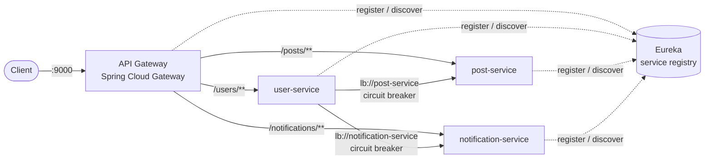

# Spring Cloud Microservices: Social Media Backend

[](https://github.com/sravani551/Microservice-example/actions/workflows/ci.yml)


A small social-media backend split into independently deployable services. It covers the core
building blocks of a Spring Cloud system: **service discovery**, an **API gateway**,
**client-side load balancing**, and **fault tolerance with circuit breakers**.



| Service | Port | Responsibility |
|---|---|---|
| `eureka-server` | 8999 | Service registry; dashboard at http://localhost:8999 |
| `api-gateway` | 9000 | Single entry point; routes by path to services resolved through Eureka (`lb://`) |
| `user-service` | 8082 | Aggregates a user profile from posts and notifications |
| `post-service` | 8083 | Posts API |
| `notification-service` | 8084 | Notifications API |

## Design highlights

- **Service discovery, no hard-coded hosts**: services register with Eureka and call each other by
  name (`http://post-service/...`) through a `@LoadBalanced` client, so instances can scale or move freely.
- **Per-dependency circuit breakers (Resilience4j)**: `user-service` wraps each downstream call in its
  own breaker. If `post-service` is down, the profile still returns, with an empty `posts` section and
  `"degraded": true`, instead of failing the whole request.
- **Timeouts on every remote call**: 2s connect/read timeouts make a slow dependency count as a failure
  for the circuit breaker instead of tying up request threads.
- **Owned contracts**: each service defines its own DTOs (Java records) for the data it consumes,
  rather than sharing a model library that would couple deployments.
- **Health and breaker state**: `user-service` exposes `/actuator/health` including circuit-breaker state.
- **One build, one image recipe**: a root aggregator POM builds all modules; a single multi-stage
  Dockerfile (dependency layer cached, non-root runtime user) builds any service via `--build-arg MODULE`.

## Run

**With Docker** (no local Java needed):

```bash
docker compose up -d --build
./scripts/smoke-test.sh          # waits for registration, then calls through the gateway
```

**Locally** (Java 17): start `eureka-server` first, then the others:

```bash
./mvnw -pl eureka-server spring-boot:run
./mvnw -pl post-service spring-boot:run
./mvnw -pl notification-service spring-boot:run
./mvnw -pl user-service spring-boot:run
./mvnw -pl api-gateway spring-boot:run
```

### Try it

```bash
curl localhost:9000/users/1            # aggregated profile
curl localhost:9000/posts/user/1
curl localhost:9000/notifications/user/1

docker compose stop post-service       # simulate an outage
curl localhost:9000/users/1            # still 200: posts empty, "degraded": true
curl localhost:8082/actuator/health    # shows the circuit breaker state (inside the network)
```

Example response:

```json
{
  "user": { "id": "1", "name": "User 1", "phone": "555-0101" },
  "posts": [ { "id": "p-1-1", "userId": "1", "title": "First post by user 1" } ],
  "notifications": [ { "id": "n-1-1", "userId": "1", "message": "Welcome, user 1!" } ],
  "degraded": false
}
```

## Tests

```bash
./mvnw verify
```

- Controller slice tests (`@WebMvcTest`) for each service
- Unit tests for the aggregation and graceful-degradation logic
- A test that checks the circuit-breaker fallback signatures: Resilience4j only finds a fallback with
  the same parameters plus a trailing `Throwable`, and a mismatch otherwise surfaces only in
  production when the breaker opens

CI (GitHub Actions) runs the full build, then starts the whole system with Docker Compose and runs
the gateway smoke test.

## Next steps

- Externalized configuration with Spring Cloud Config
- Distributed tracing (Micrometer Tracing + Zipkin) across gateway and services
- Replace in-memory sample data with per-service databases
- Authentication at the gateway (OAuth2 / JWT resource server)
